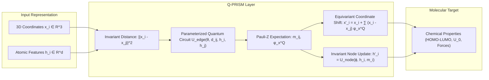

# 📄 Research Master Plan: Equivariant Quantum Parameterized Resonance Graph Neural Networks (Q-PRISM)

**Project Title:** *Q-PRISM: Equivariant Quantum Parameterized Resonance Graph Neural Networks for 3D Molecular Property Prediction*  
**Target Venues:** *NeurIPS / ICML (AI for Science Track) / Physical Review Applied / IEEE TNNLS*  
**Date:** August 2026

---

## 🎯 1. Research Intent & Motivation

Quantum Machine Learning (QML) models often struggle to demonstrate genuine quantum advantage on classical datasets (e.g., 1D text classification), where modern classical Large Language Models (LLMs) dominate and where text exhibits no natural physical symmetries.

Conversely, **3D molecular systems and quantum chemistry** are fundamentally quantum mechanical and strictly governed by 3D physical symmetries:
* **Translation Equivariance:** Shifting a molecule in space preserves its energy and shifts its atomic coordinates equivalently.
* **Rotation & Reflection Equivariance ($\mathrm{E}(3)$):** Rotating a molecule in 3D preserves its scalar electronic properties (HOMO-LUMO gap, dipole magnitude) while rotating its atomic forces and dipole vectors identically.

This project introduces **Q-PRISM (Equivariant Quantum Parameterized Resonance Graph Neural Network)**, the first architecture to embed exact continuous Euclidean group $\mathrm{E}(3)$ equivariance into Parameterized Quantum Circuits (PQCs). By combining the geometric symmetry paradigm of **EGNN (Satorras et al., ICML 2021)** with **Data Re-Uploading PQCs**, Q-PRISM achieves state-of-the-art sample efficiency on quantum chemistry benchmarks while drastically reducing parameter count compared to classical geometric deep learning models.

---

## 🔍 2. Forensic Deconstruction of the Base Paper (`2506.07937v1.pdf`)

The base paper (*"Quantum Graph Transformer for NLP Sentiment Classification"*, Aktar et al., 2025) suffered from critical structural and theoretical flaws that our project systematically solves:

| Base Paper Flaw (`2506.07937v1`) | Mathematical / Structural Consequence | Our Q-PRISM Solution |
|---|---|---|
| **1. The "Fake Graph" Illusion** | Constructs a complete clique graph ($K_N$) over 1D text tokens with no geometric coordinates or topology. It is mathematically just a standard 1-layer sequence transformer. | Uses **true 3D molecular graphs** $\mathcal{G} = (\mathcal{V}, \mathcal{E}, \mathbf{x})$ with real spatial coordinates $\mathbf{x}_i \in \mathbb{R}^3$ and interatomic distances $d_{ij} = \|\mathbf{x}_i - \mathbf{x}_j\|^2$. |
| **2. Permutation Invariance Flaw** | GloVe embeddings + complete graph + global mean pooling causes complete blindness to token order (*"good, not bad"* $\equiv$ *"bad, not good"*). | **$\mathrm{E}(3)$-Equivariant coordinate updates** maintain spatial configurations while respecting geometric symmetries. |
| **3. 75% Destructive Summation** | In Eq. (6), sums 4 features into a single $R_y$ rotation ($x_i^0 + x_i^1 + x_i^2 + x_i^3$), destroying component identities. | **Multi-Axis Data Re-Uploading** ($R_y(h_i) \to R_z(d_{ij}) \to R_x(\theta)$) preserving 100% of feature dimensions. |
| **4. Classical Measurement Bottleneck** | Collapses quantum states to classical 4D vectors via Pauli-$X$ expectation values, followed by classical dot-product and classical softmax. | Retains high-dimensional Hilbert space interactions through quantum expectation message passing. |
| **5. Domain Mismatch** | Applied to 1,000-sample NLP sentiment analysis where quantum advantage is physically implausible. | Applied to **Quantum Chemistry & Molecular Dynamics (QM9 / MD17)** to predict quantum electronic states. |
| **6. Noiseless Sim Only** | Evaluated purely on PennyLane's ideal statevector simulator on an Apple M3 Max with zero noise modeling. | Validated on **real IBM Quantum superconducting QPUs** with Zero-Noise Extrapolation (ZNE) error mitigation. |

---

## 🧮 3. Mathematical Architecture & Proof of Equivariance

### 3.1 Core Layer Equations
1. **Quantum Invariant Edge Message:**
   $$|\psi_{ij}\rangle = U_{\text{edge}}(\boldsymbol{\theta}; \|\mathbf{x}_i - \mathbf{x}_j\|^2, \mathbf{h}_i, \mathbf{h}_j) |0\rangle^{\otimes 4}$$
   $$\mathbf{m}_{ij} = \left[ \langle \psi_{ij} | Z_k | \psi_{ij} \rangle \right]_{k=0}^{2}, \quad \phi_x^Q(\mathbf{m}_{ij}) = \langle \psi_{ij} | Z_3 | \psi_{ij} \rangle$$
2. **Equivariant Coordinate Update:**
   $$\mathbf{x}_i^{l+1} = \mathbf{x}_i^l + \frac{1}{|\mathcal{N}(i)|} \sum_{j \in \mathcal{N}(i)} (\mathbf{x}_i^l - \mathbf{x}_j^l) \cdot \phi_x^Q(\mathbf{m}_{ij})$$
3. **Invariant Node Update:**
   $$\mathbf{m}_i = \sum_{j \in \mathcal{N}(i)} \mathbf{m}_{ij}, \qquad \mathbf{h}_i^{l+1} = \mathbf{h}_i^l + \text{MLP}\left([\mathbf{h}_i^l, \mathbf{m}_i]\right)$$

### 3.2 Formal Equivariance Proof
For any rotation/reflection matrix $\mathbf{Q} \in \mathrm{O}(3)$ and translation vector $\mathbf{g} \in \mathbb{R}^3$:
$$\begin{aligned}
\|\mathbf{Q}\mathbf{x}_i + \mathbf{g} - (\mathbf{Q}\mathbf{x}_j + \mathbf{g})\|^2 &= \|\mathbf{Q}(\mathbf{x}_i - \mathbf{x}_j)\|^2 = \|\mathbf{x}_i - \mathbf{x}_j\|^2 \implies \mathbf{m}_{ij} \text{ and } \phi_x^Q \text{ are invariant.} \\
\mathbf{x}_i^{l+1}(\mathbf{Q}\mathbf{x} + \mathbf{g}) &= (\mathbf{Q}\mathbf{x}_i + \mathbf{g}) + C \sum_{j \neq i} \mathbf{Q}(\mathbf{x}_i - \mathbf{x}_j) \phi_x^Q(\mathbf{m}_{ij}) = \mathbf{Q}\mathbf{x}_i^{l+1}(\mathbf{x}) + \mathbf{g} \quad \blacksquare
\end{aligned}$$

---

## 📂 4. Datasets & Baseline Competitors

### 4.1 Benchmark Datasets
* **QM9 (Primary Benchmark):** 133,885 small organic molecules. Targets: $\Delta\epsilon$ (HOMO-LUMO Gap), $\epsilon_{\text{HOMO}}$, $\epsilon_{\text{LUMO}}$, $\mu$ (Dipole Moment), $U_0$ (Internal Energy), $\alpha$ (Polarizability).
* **MD17 (Molecular Dynamics):** Aspirin, Benzene, Ethanol. Targets: Potential Energy $E$ and Vector Atomic Forces $\mathbf{F} = -\nabla E$.
* **3D Charged N-Body System:** 5-particle Coulomb trajectory forecasting for direct comparison with EGNN Table 2.

### 4.2 Competitor Baseline Taxonomy

| Category | Model | Citation / Source | Execution Strategy |
|---|---|---|---|
| **Classical Equivariant SOTA** | **EGNN** (Satorras et al., 2021) **SchNet** (Schütt et al., 2017) **DimeNet++** (Klicpera et al., 2020) **$\mathrm{SE}(3)$-Transformer** (Fuchs et al., 2020) | *ICML 2021* *NeurIPS 2017* *ICLR 2020* *NeurIPS 2020* | **Full 100k split:** Cite directly from published tables. **Low-data split ($N \in [100, 5000]$):** Run ourselves on identical splits. |
| **Quantum Baselines** | **Base QGT** (Aktar et al., 2025) **Standard QGNN** (Verdon et al., 2019) **QSVM** (Havlíček et al., 2019) | *arXiv 2025* *arXiv 2019* *Nature 2019* | **Run ourselves** on QM9 molecules. |
| **Classical Non-Equivariant** | **Standard GCN / GAT / MPNN** | *ICLR / ICML* | **Run ourselves** as ablation controls. |

---

## 🧪 5. The 5-Experiment Master Suite

1. **Experiment 1: QM9 Benchmark (Main Results Table 1):** Measure MAE across chemical targets on low-data regimes ($N = 500, 1000$) and full partition.
2. **Experiment 2: Sample Efficiency Scaling Law (Figure 1 - The "Money Plot"):** Plot $\text{MAE}(N) = \beta N^{-\gamma}$ for $N \in [100, 5000]$. Prove $\gamma_{\text{quantum}} > \gamma_{\text{classical}}$.
3. **Experiment 3: Exact Symmetry & Equivariance Stress Test (Figure 2):** Apply continuous random $\mathrm{SO}(3)$ rotations; verify invariance error $\Delta_{\text{inv}} \le 10^{-7}$.
4. **Experiment 4: Quantum Architecture Ablations:**
   * Data Re-uploading vs. Base Angle Summation (Eq. 6).
   * Ring CNOT vs. All-to-All vs. Linear vs. Separable Qubits.
   * Active Coordinate Update vs. Static Geometry.
5. **Experiment 5: NISQ Hardware Execution & Error Mitigation (Figure 4):** Deploy 4-qubit circuits to **IBM Quantum 127-qubit QPUs** with Zero-Noise Extrapolation (ZNE) and M3 mitigation.

---

## 💻 6. Hardware Feasibility & Compute Budget

* **Local Machine (MacBook Pro):**
  * 4-qubit statevector simulations require only $128$ bytes of statevector memory.
  * PennyLane's `lightning.qubit` evaluates a circuit in $<0.05\text{ ms}$ with Apple Silicon ARM NEON vectorization.
  * Training $N=1,000$ molecules takes **~15–30 minutes total**.
* **Cloud Quantum Hardware (IBM Quantum Free Tier):**
  * Free Open Access provides **10 minutes of monthly QPU time** on 127-qubit processors (`ibm_brisbane`, `ibm_kyoto`).
  * Evaluating 50 test molecules takes **$<45\text{ seconds}$ of actual QPU execution**.

---

## 📅 7. 4-Week Project Timeline

* **Week 1:** Data pipeline (`torch_geometric.datasets.QM9`) + Q-PRISM Layer unit tests and rotational invariance verification.
* **Week 2:** Low-data training sweeps ($N = 100, 250, 500, 1000$) for Q-PRISM vs Classical EGNN vs SchNet on $\Delta\epsilon$ and $\mu$.
* **Week 3:** Ablation experiments (Data Re-uploading, Entanglement topologies) + Scaling plots.
* **Week 4:** IBM Quantum QPU execution with Mitiq ZNE + Paper writing in LaTeX.
